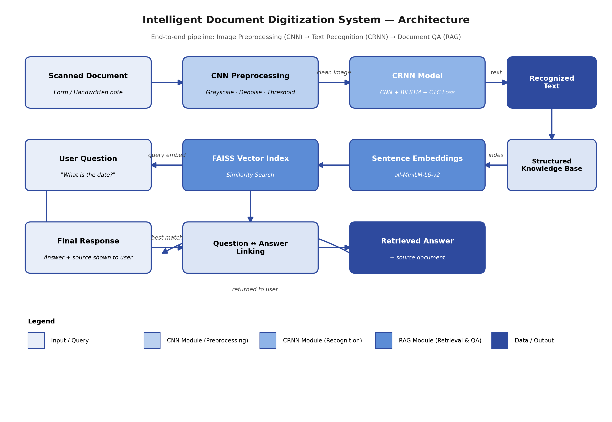

# Intelligent Document Digitization System

An AI system that reads handwritten text from images (CRNN) and answers plain-English questions about scanned forms (RAG).

**Author:** Prarit (Roll No: 2415001144)



## What it does

1. **Image preprocessing (CNN stage):** a scanned document is converted to grayscale, denoised and thresholded using OpenCV.
2. **Text recognition (CRNN):** a CNN + bidirectional LSTM model trained with CTC loss reads handwritten words from images.
3. **Document question answering (RAG):** text fields of a form are embedded with Sentence-BERT, indexed with FAISS, and a user question is matched to the closest field. The linked answer field is returned along with the source document.

## Results

| Component | Test | Result |
|---|---|---|
| CRNN handwriting recognition | 300 unseen validation images | **82.89%** character accuracy (CER 17.11%), **43.67%** exact word match |
| RAG question answering | 100 question-answer pairs from FUNSD forms | **87 / 100** correct |

Notes on how these were measured:
- CRNN was trained on 30,000 samples for 25 epochs (Adam, lr 0.0005, gradient clipping, batch size 64) on an NVIDIA RTX 4050 GPU. The full dataset has about 330,000 samples, so more training should improve accuracy.
- The RAG test builds each question from a form's own field labels (for example "What is the date?"), so it is an easier test than free-form questions.

## Datasets

| Dataset | Used for | Size |
|---|---|---|
| FUNSD | Form structure and question-answer links | 149 training forms, 7,259 text fields |
| IAM handwriting images (Kaggle version, `written_name_*_v2.csv`) | CRNN training and validation | 330,294 labelled training images |

The datasets are **not included** in this repository because of their size. See Setup below.

## Project structure

```
Document-Digitization-system/
├── notebooks/Untitled.ipynb      # preprocessing, CRNN training, evaluation, RAG pipeline
├── models/crnn_model_v2.pth      # trained CRNN weights (use this one)
├── system_architecture.png       # architecture diagram
├── requirements.txt
└── README.md
```

## Setup

1. Create a virtual environment and install the requirements:
   ```
   python -m venv venv
   venv\Scripts\activate
   pip install -r requirements.txt
   ```
   For GPU training, install the CUDA build of PyTorch instead of the default one, for example:
   ```
   pip install torch torchvision torchaudio --index-url https://download.pytorch.org/whl/cu124
   ```
2. Download the datasets into a `data/` folder:
   - FUNSD: https://guillaumejaume.github.io/FUNSD/dataset.zip, extract so that `data/FUNSD/dataset/training_data/` exists.
   - IAM handwriting images: place `train_v2/`, `validation_v2/`, `test_v2/` and the `written_name_*_v2.csv` files in `data/IAM/`.
3. Run `jupyter notebook` and open `notebooks/Untitled.ipynb`. Run cells one by one. To skip training, load `models/crnn_model_v2.pth` instead of running the training cell.

## Current limitations

- The CRNN is trained on handwritten names (letters only, no digits), so it is not evaluated on printed form text or numbers.
- The RAG stage currently uses the annotated text provided with FUNSD, not the output of the CRNN. Connecting the two end to end is future work.
- Exact word accuracy (43.67%) is modest because of limited training. More data and epochs should help.

## References

- Shi, Bai, Yao. *An End-to-End Trainable Neural Network for Image-based Sequence Recognition* (CRNN), 2016.
- Jaume, Ekenel, Thiran. *FUNSD: A Dataset for Form Understanding in Noisy Scanned Documents*, 2019.
- Marti, Bunke. *The IAM-database: An English Sentence Database for Offline Handwriting Recognition*, 2002.
- Lewis et al. *Retrieval-Augmented Generation for Knowledge-Intensive NLP Tasks*, 2020.
- Reimers, Gurevych. *Sentence-BERT*, 2019.
